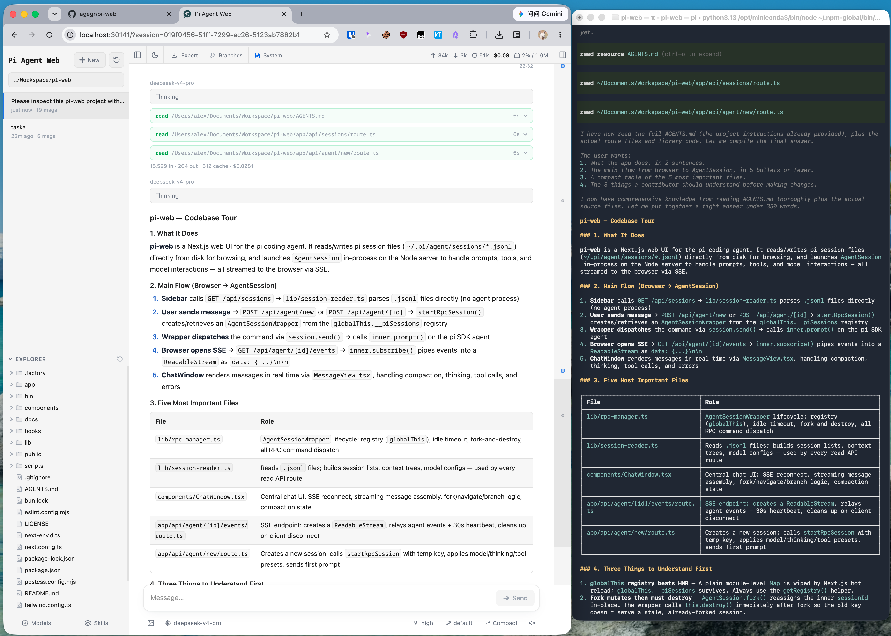

# Pi Web

[English](../README.md) | [简体中文](./README.zh-CN.md) | [Русский](./README.ru.md)

[pi コーディングエージェント](https://github.com/earendil-works/pi) のローカルブラウザー UI です。Pi Web は pi と同じローカル設定とセッションファイルを使用し、ブラウザーから会話の検索と再開、エージェントの実行、モデルやリソースの設定、プロジェクトファイルの確認を行えます。

**[インタラクティブデモを試す →](https://agegr.github.io/pi-web/)**：実際の Pi Web UI がブラウザー内だけで動作し、サンプルのセッション、ファイル、モデルを確認できます。インストールは不要です。返信はあらかじめ用意された内容で、モデルは呼び出しません。



## 機能

- **セッションワークスペース**：プロジェクトごとに会話を閲覧、再開、名前変更、エクスポート、削除し、実行状態、コンテキスト使用量、コスト、コンパクション情報を確認できます。
- **2 種類の分岐**：**New session** は以前のメッセージから独立したセッションファイルを作成し、**Edit from here** は現在のセッション内にブランチを作成します。
- **プロジェクトファイルツール**：ファイルの閲覧とアップロード、Git Diff の確認、ソース、Markdown、画像、音声、PDF、DOCX のプレビューに対応し、変更時は自動更新されます。
- **Git worktree**：同じリポジトリのセッションをまとめたまま、サイドバーからチェックアウトを切り替えられます。
- **Web での設定**：Pi Web を離れずに、Provider のログインと API Key、モデル、モデルテスト、プラグインパッケージ、スキルを管理できます。
- **英語、簡体字中国語、繁体字中国語の UI**：初回はブラウザーの言語に従い、設定 → 一般 → 言語から切り替えられます。

## クイックスタート

Pi Web には Node.js 22.19.0 以降が必要です。`node --version` でバージョンを確認してから、次を実行します：

```bash
npx @agegr/pi-web@latest
```

サーバーの準備が整うと、CLI はブラウザーを自動的に開こうとします。開かない場合は [http://127.0.0.1:30141](http://127.0.0.1:30141) にアクセスしてください。Pi Web はデフォルトで `127.0.0.1` のみをリッスンします。

モデル Provider が未設定の場合は、**Models** パネルを開いてログインするか API Key を追加してください。

`pi-web` コマンドをグローバルにインストールする場合：

```bash
npm install -g @agegr/pi-web@latest
pi-web
```

コマンド：

```bash
pi-web version          # インストール済みのバージョンを表示
pi-web status           # 実行中のサーバーを一覧表示
pi-web stop [--port N]  # 実行中のサーバーを停止
pi-web open [--port N]  # 実行中のサーバーをブラウザーで開く
pi-web update [--check] # グローバル npm インストールを更新
```

更新時は `pi-web stop` を実行してから `pi-web update` を実行します（同じインストールコマンドの再実行でも構いません）。アンインストールするには `npm uninstall -g @agegr/pi-web` を実行します。

## 設定

ポートとホスト名では、コマンドラインオプションが対応する環境変数より優先されます。`--no-open` と `PI_WEB_NO_OPEN=1` は、どちらを指定してもブラウザーの自動起動が無効になります。`pi-web --help`（または `-h`）で起動オプションを表示して終了します。未知のオプションはエラーで終了します。

| オプションまたは環境変数 | 用途 | デフォルト |
| --- | --- | --- |
| `--help`、`-h` | 起動オプションを表示して終了 | — |
| `--port <port>`、`-p <port>`、または `PORT` | サーバーポート | `30141` |
| `--hostname <host>`、`-H <host>`、または `PI_WEB_HOSTNAME` | バインドするホスト名 | `127.0.0.1` |
| `--no-open` または `PI_WEB_NO_OPEN=1` | ブラウザーを自動的に開かない | 自動的に開く |
| `PI_WEB_APP_NAME` | PWA マニフェストの `name` と `short_name`。前後の空白は取り除かれ、空の値はデフォルトを使用 | `Pi Web` |
| `PI_WEB_SKIP_VERSION_CHECK=1` | Pi Web の更新チェックを無効化 | 未設定 |
| `PI_WEB_ALLOWED_HOSTS` | 追加で許可するプロキシまたはカスタムホスト名。複数指定はカンマ区切りで完全一致 | 未設定 |
| `PI_WEB_PASSWORD` | ブラウザーのパスワードログインを有効化。API はユーザー名 `pi` の Basic Auth も利用可能 | 認証なし |
| `PI_WEB_IDLE_TIMEOUT_MS` | セッションのアイドルタイムアウト（ミリ秒、最大 `2147483647`）。`0` でアイドル時の終了を無効化。無効または範囲外の値はデフォルトを使用 | `600000`（10 分） |
| `PI_WEB_SHUTDOWN_DEADLINE_MS` | セッションを閉じるとき、拡張機能が `session_shutdown` を処理するまでの猶予（ミリ秒、最大 `2147483647`）。過ぎるとセッションはそのまま破棄される。`0`、無効または範囲外の値はデフォルトを使用 | `5000`（5 秒） |
| `PI_CODEMODE_MAX_WORKERS` | 同時に実行できる codemode スクリプト数に対する pi の上限。サーバー内のすべてのセッションとサブエージェントで共有。pi 自体のデフォルトは `2` で、未設定または空の場合 pi-web は `8` を設定。各スクリプトは最大 256 MB を使用可能 | `8` |

`PI_WEB_APP_NAME` はサーバーを起動する前に設定してください（例：`PI_WEB_APP_NAME='Work Pi' pi-web`）。変更後にサーバーを再起動すると新しいマニフェストが配信され、再ビルドは不要です。インストール済み PWA の名前の更新はブラウザーが管理するため、すぐに反映されるとは限りません。ページタイトルやアイコンは変わりません。

例：

```bash
pi-web --help
pi-web -p 8080 -H 0.0.0.0 --no-open
```

### リモートアクセス

ループバック以外のアドレスにバインドすると、高い権限の操作を実行できるエージェントがネットワークに公開されます。信頼できる LAN で使用する場合も、十分に長いランダムなパスワードを設定してください：

```bash
PI_WEB_PASSWORD='十分に長いランダムなパスワード' pi-web --hostname 0.0.0.0
```

パスワード認証は接続を暗号化しません。平文 HTTP で Pi Web をインターネットに公開せず、信頼できるリバースプロキシによる HTTPS または信頼できる VPN を使用してください。リバースプロキシが外部ホスト名を転送する場合は、その名前を完全一致で `PI_WEB_ALLOWED_HOSTS` に追加します。この許可リストは Pi Web のバインド先を変更しません。

多数のチャット、ターミナル、ファイルプレビューを同時に使うと、平文 HTTP ではブラウザーの接続が 6 本までに制限され、リクエストが待たされます。[Serving Pi Web over HTTP/2](./http2.md) を参照してください。

### Docker

リリースごとに `ghcr.io/agegr/pi-web` へイメージを公開しています。イメージ、Compose の例、保持すべきボリュームについては [Running Pi Web in Docker](./docker.md) を参照してください。

### HTTP プロキシ

サーバー側のモデルリクエストと API リクエストは、標準の `HTTP_PROXY`、`HTTPS_PROXY`、`NO_PROXY` 環境変数を使用します。

macOS または Linux：

```bash
HTTP_PROXY=http://127.0.0.1:7890 \
HTTPS_PROXY=http://127.0.0.1:7890 \
NO_PROXY=localhost,127.0.0.1 \
npx @agegr/pi-web@latest
```

Windows PowerShell：

```powershell
$env:HTTP_PROXY = "http://127.0.0.1:7890"
$env:HTTPS_PROXY = "http://127.0.0.1:7890"
$env:NO_PROXY = "localhost,127.0.0.1"
npx @agegr/pi-web@latest
```

## 注意事項

- **エージェントデータ**：Pi Web はデフォルトで `~/.pi/agent` の pi データを読み込みます。セッションファイルは `sessions/<encoded-cwd>/<timestamp>_<uuid>.jsonl` にあります。別の pi エージェントディレクトリを使用するには `PI_CODING_AGENT_DIR` を設定してください。
- **ファイルシステムへのアクセス**：Pi Web はエージェントデータディレクトリと、セッションに記録された作業ディレクトリを読み取れる必要があります。既存の pi セッションを共有する場合は、pi と同じファイルシステム環境で Pi Web を実行してください。
- **共有設定**：Models パネルは pi のモデル、設定、認証情報ストレージを使用するため、変更は両方のインターフェースに反映されます。開いているセッションでは、保存したモデルの変更はそのモデルを選び直したときに適用されます。
- **ファイルアクセスの範囲**：ファイルブラウザーは、Pi Web で選択した作業ディレクトリと、既知のプロジェクトまたはセッションルートに限定されます。汎用のファイルシステムブラウザーではありません。
- **Git worktree**：スイッチャーの表示条件、worktree の作成、削除時の動作については [Worktrees in Pi Web](./worktrees.md) を参照してください。
- **連携フック**：Pi Web を組み込むアプリはセッション行のコンテキストメニューを置き換えられ、サーバー側の pi 拡張機能はセッションのアイドル終了を防げます。[Integration Hooks](./integrations.md) を参照してください。

## 開発

```bash
npm install
npm run dev
```

開発サーバーは [http://127.0.0.1:30141](http://127.0.0.1:30141) で動作します。一般的なチェックは次のコマンドで実行します：

```bash
npm test
node_modules/.bin/tsc --noEmit
npm run lint
```

通常の開発中は `next build` または `npm run build` を実行しないでください。`.next/` に書き込まれ、開発サーバーに影響する可能性があります。ビルドはリリース作業時にのみ実行してください。

新機能に取りかかる前に、[Contributing](../CONTRIBUTING.md) で対象範囲とプルリクエスト前のチェック項目を確認してください。

コントリビューター向けガイド：[Internationalization](./i18n.md) と [Release process](./release.md)。

## リポジトリ構成

```text
app/             Next.js UI と API ルート
components/      React UI コンポーネント
hooks/           クライアントの状態と操作に関する hooks
lib/             セッション、エージェント、モデル、ファイル、Git、セキュリティのロジック
public/          静的アセットと PWA ファイル
bin/             npm CLI エントリポイントと起動オプションの解析
docs/            ユーザーおよびコントリビューター向けの個別ガイド
demo/            GitHub Pages で公開する静的デモ（demo/README.md を参照）
```

アーキテクチャの説明、API ルート、トピックノートについては [AGENTS.md](../AGENTS.md) を参照してください。

## ライセンス

[MIT](../LICENSE)
